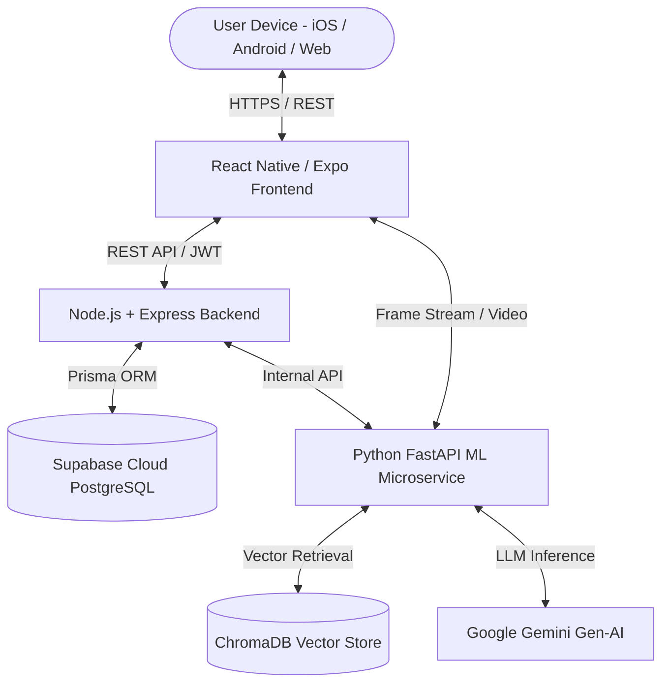

# 🎯 AI Mentor – Intelligent Interview Preparation & Assessment Ecosystem

<p align="center">
  
  
  
  
  
  
</p>

---

## 📌 Overview

**AI Mentor** is an all-in-one, intelligent career readiness and interview preparation platform built for software engineering students and tech job seekers. It simulates high-stakes technical, behavioral, and system design interviews through **real-time AI feedback**, **camera gaze tracking**, **automated code execution**, and **deep ATS resume diagnostics**.

---

## 🏗️ System Architecture

The project is structured as a scalable, production-ready **Microservices Architecture**:

```
Interview-Preperation-App/
├── frontend/          # React Native (Expo SDK 58) Mobile & Web Client
├── backend/           # Node.js + Express + TypeScript + Prisma ORM
├── ML-model/          # Python FastAPI + ChromaDB (RAG) + OpenCV + Gemini
├── k8s/               # Kubernetes Deployment Manifests
└── docker-compose.yml # Complete Multi-container Orchestration
```



---

## ✨ Core Features

### 1. 🎙️ AI Mock Interviewer with Real-Time Gaze Tracking
* Conducts real-time **Technical**, **Behavioral (STAR method)**, and **System Design** interviews.
* **Camera Gaze Detection:** Uses OpenCV and computer vision to analyze eye contact, candidate focus, and confidence in real-time.
* Evaluates candidate answers using **Google Gemini** with structured scores for clarity, depth, and relevance.

### 2. 💻 Interactive Coding Sandbox & Automated Judge
* In-app code editor supporting multiple programming languages (TypeScript, JavaScript, Python).
* Executes code against hidden test cases with timeout protection, stdout capturing, and memory benchmarking.
* Provides automated feedback on Time and Space Complexity ($O(n)$, $O(1)$) along with optimal solutions.

### 3. 📄 ATS Resume Diagnostic & Keyword Optimizer
* In-depth parsing of resume documents (PDF / Text).
* Evaluates **ATS Compatibility Score**, **Impact Scoring**, and **Formatting Readiness**.
* **Keyword Gap Analysis:** Compares candidate resumes against target job descriptions (e.g., Full Stack Developer, DevOps Engineer) to recommend critical missing keywords.

### 4. 🧠 RAG-Augmented AI Career Coach (Retrieval-Augmented Generation)
* 24/7 interactive chat mentor backed by an indexed knowledge base of technical topics, interview guides, and coding patterns.
* Utilizes **Sentence-Transformers** embeddings and **ChromaDB** semantic vector search to provide verified, hallucination-free advice.

### 5. 🏆 Leadership & Behavioral Assessment (MCQ)
* Curated multiple-choice assessments modeled after **FAANG & Amazon Leadership Principles** to prepare candidates for culture-fit rounds.

---

## 🛠️ Tech Stack

| Domain | Technology | Purpose |
| :--- | :--- | :--- |
| **Frontend** | React Native (Expo SDK 58), Expo Router, TypeScript | Cross-platform mobile (iOS, Android) and responsive web UI |
| **Core Backend** | Node.js, Express, TypeScript | REST API, authentication, business logic, test runner |
| **ORM & DB** | Prisma ORM, PostgreSQL (Supabase Cloud) | Type-safe queries, migration management, relational data |
| **AI / ML Service** | Python 3.10+, FastAPI, Uvicorn | High-performance asynchronous AI microservice |
| **Vector DB** | ChromaDB, Sentence-Transformers (`all-MiniLM-L6-v2`) | Embeddings storage & semantic document retrieval (RAG) |
| **LLM Engine** | Google Gemini (`gemini-3.5-flash` / Generative AI) | Answer evaluation, coaching feedback, ATS parsing |
| **Computer Vision** | OpenCV / MediaPipe | Real-time candidate gaze & eye-contact tracking |
| **DevOps** | Docker, Docker Compose, Cloudflare Tunnels | Multi-container deployment and secure remote tunneling |

---

## 🚀 Getting Started (Local Setup)

### Prerequisites
* **Node.js**: `v20.x` or higher
* **Python**: `3.10` or higher
* **Git**

---

### 1. Backend Setup

```bash
cd backend

# Install dependencies
npm install

# Push Prisma Schema to Database
npm run prisma:push

# Start development server
npm run dev
```
*Backend runs at: `http://localhost:5000`*

#### Backend Environment Variables (`backend/.env`):
```env
PORT=5000
NODE_ENV=development
CLIENT_URL=http://localhost:8081
JWT_SECRET=your_jwt_secret_key
DATABASE_URL="your_postgresql_supabase_connection_string"
DIRECT_URL="your_direct_session_url"
GEMINI_API_KEY=your_gemini_api_key
ML_SERVICE_URL=http://127.0.0.1:8001
```

---

### 2. Python ML Microservice Setup

```bash
cd ML-model

# Create & activate virtual environment
python -m venv venv
.\venv\Scripts\activate       # On Windows
source venv/bin/activate     # On macOS/Linux

# Install dependencies
pip install -r requirements.txt

# Run FastAPI server
python main.py
```
*ML Service runs at: `http://localhost:8001` (API Docs: `http://localhost:8001/docs`)*

#### ML Microservice Environment Variables (`ML-model/.env`):
```env
PORT=8001
HOST=0.0.0.0
GEMINI_API_KEY=your_gemini_api_key
CHROMA_HOST=localhost
CHROMA_PORT=8100
```

---

### 3. Frontend Setup

```bash
cd frontend

# Install dependencies
npm install --legacy-peer-deps

# Start Metro Bundler
npx expo start -c
```
* Scan the displayed QR code with **Expo Go** (iOS / Android) or press `w` to open in your web browser.

---

### 4. Running with Docker Compose (Single Command)

To run the entire ecosystem (Postgres, ChromaDB, ML Model, Backend, Frontend) concurrently:

```bash
docker compose up --build -d
```

---

## 🔒 Security Best Practices Implemented
* **Password Hashing:** Salted Bcrypt encryption.
* **Authentication:** Stateless, cryptographically signed JSON Web Tokens (JWT).
* **API Protection:** Integrated `helmet` headers, CORS whitelisting, and `express-rate-limit` for DDoS/brute-force prevention.
* **Sandbox Safety:** Code execution service isolated from host file system.

---

## 📄 License
This project is developed for educational and portfolio demonstration purposes. All rights reserved.
